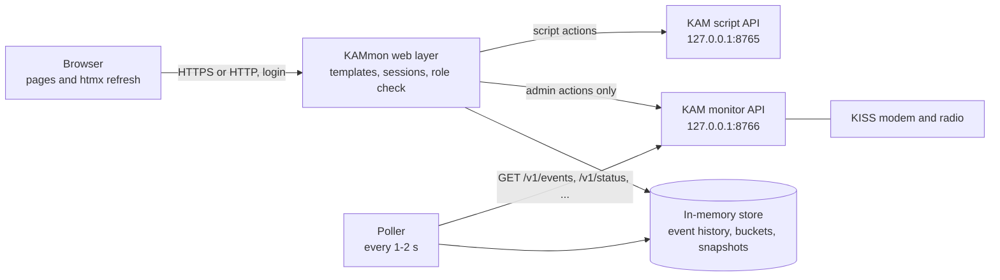

# KAMmon Design

**Status:** Design pattern taken from the clickable prototype [prototype/kammon-prototype.html](../prototype/kammon-prototype.html). The prototype uses sample data only and is thrown away after the build.
**Scope:** How KAMmon looks, how it is built, and how it behaves. What each page must do is in the files in [requirements/](requirements/). What KAM must offer is in [docs/kam-api/FeatureMonitorApi.md](kam-api/FeatureMonitorApi.md).

## 1. Purpose

KAMmon is a web monitor for one KAM node. It runs on the same computer as KAM, talks to KAM over a local REST API, and shows an operator:

- what the radio is hearing and how busy the channel is (airtime and packet types)
- what the channels and the room servers are doing
- who is a member of each room, and what role they have
- the Starlark scripts, with tools to write and test them
- the KISS modem, with its radio settings

It is built for hobbyists. The page should make sense to someone who is new to radio, so the screen explains itself in plain words and never claims more than KAM knows.

## 2. Principles

1. **Calm and dense.** A quiet charcoal console, small text, no cards, no decoration. Hierarchy comes from type size and spacing.
2. **Honest labels.** Say what the number means. "Remembered clients" is not "online". "Echo" is not "verified". "Stale" is not "expired". See §8.
3. **Read first, change second.** Every page works as a read-only view. Controls that change something appear only for the local administrator.
4. **Simple on purpose.** One Go program, one config file, no database, no build step for the front end, no new dependency without a clear reason.
5. **KAM is open, KAMmon is a client.** KAM runs the radio, channels, rooms and scripts, and works fine without KAMmon. KAMmon only supplies the screens, the login and its own memory. KAM does not know KAMmon exists, so nothing in KAMmon may ask KAM to remember something for it. A slow, stopped or missing KAMmon changes nothing for KAM.

## 3. Architecture



- **Poller.** A goroutine asks KAM for new events and a status snapshot, then writes them into the store. It is the only reader of the event feed.
- **Store.** Memory only (see [requirements/DataStore.md](requirements/DataStore.md)). Pages read from the store, not from KAM, so a page view never waits on KAM.
- **Web layer.** Server-rendered pages. A browser asks for a whole page once; htmx then refreshes small parts of it.
- **Actions.** Changes (room-client removal, modem radio, scripts) go straight to KAM, one request each, and the answer is shown on screen. They are never automatically retried.
- **Two KAM addresses.** `kam_monitor_url` (default `http://127.0.0.1:8766`) and `kam_scripts_url` (default `http://127.0.0.1:8765`).
- **KAMmon owns web users and web permissions:** login passwords, browser sessions, the viewer allow list, view rules, theme, and its in-memory history. KAM still owns MeshCore room passwords and radio client sessions; these are separate from KAMmon web users. KAM keeps no state for KAMmon, and a slow or restarting KAM leaves every page usable, marked as out of date.

### 3.1 Roles

| Role | How it is recognised | Can do |
|---|---|---|
| **Viewer** | A user with `role: viewer` in `kammon.yml`, logged in from anywhere | Look at pages. Channel text only for allow-listed channels. No labels, no room posts. No controls. |
| **Admin** | A user with `role: admin`, **and** the request comes from a loopback address | Everything a viewer sees, plus message text, room posts, client labels, and every control. |

- Roles follow the user, but admin power also needs a loopback request. An admin who logs in from the internet gets viewer access.
- Controls are not just hidden. Routes that change something are not served at all to a viewer, so a hand-made request fails the same way.
- Passwords are plain text in `kammon.yml`, like KAM's channel keys.

## 4. Layout

### 4.1 Shell

```text
+-----------+--------------------------------------------------+
| KAM mon   |  Emmen / home node    [theme] user  [role] [out] |  top bar
| Workspace +--------------------------------------------------+
| Overview  |  Page title                    [range] [pause]   |  page heading
| Traffic   |  one-line subtitle                               |
| Channels  +--------------------------------------------------+
| Rooms     |  ... page content ...                            |
| Accounts  |                                                  |
| Automations|                                                 |
| KISS modem|                                                  |
| node info |                                                  |
+-----------+--------------------------------------------------+
```

- Left sidebar, 224 px (190 px under 1100 px). Active item: soft fill, 2 px edge on the left, stronger text, `aria-current="page"`.
- The node block at the bottom of the sidebar shows the node name, link state, radio summary and uptime.
- Under 768 px the sidebar becomes a top strip with a scrolling row of page buttons.
- Time range and pause controls appear only on the Overview, the one page that uses them.

### 4.2 Page patterns

| Pattern | Used by | Shape |
|---|---|---|
| **Metric strip + split** | Overview | Four numbers in a ruled row. Below: a main column (chart, packet mix) and a 340 px side column (recent packets, rooms, automation health). |
| **Master-detail** | Channels, Rooms, Automations | A 240 px list on the left (210 px for scripts), detail on the right. Under 768 px the list becomes a horizontal scroll row. |
| **Filter + table** | Traffic, Accounts | A filter bar, then one wide table in a scroll region. |
| **Form + snapshot** | KISS modem | Settings form in the main column, live readings and the command log in a 340 px side column. |

The page never has framed sections. Rules (1 px lines) separate regions; containers are only used for the script editor, the command log and dialogs.

## 5. Visual system

### 5.1 Colour

The prototype defines both themes with the same variable names the app uses.

| Token | Dark (default) | Light | Use |
|---|---|---|---|
| `--bg-0` | `#101012` | `#ffffff` | Page |
| `--bg-1` | `#18181b` | `#f8fafc` | Sidebar, editor bars |
| `--bg-2` | `#222225` | `#f1f5f9` | Controls, active list item |
| `--bg-3` | `#2c2c30` | `#e2e8f0` | Hover, toasts |
| `--text-primary` | `#f5f5f7` | `#0f172a` | Main text |
| `--text-secondary` | `#c5c5ca` | `#334155` | Table cells, body copy |
| `--text-muted` | `#a1a1a8` | `#526174` | Labels, captions |
| `--signal` | `#80b8ff` | `#2563eb` | **Headings**, links, primary buttons, focus |
| `--success` | `#3ddc91` | `#147a43` | Healthy, fresh, TX ok |
| `--warning` | `#f5b544` | `#a45b00` | Adverts, recent, caution |
| `--danger` | `#ff7188` | `#c42c48` | Errors only |
| `--border-subtle` | `#ffffff0f` | `#0000000f` | Row dividers |
| `--border-default` | `#ffffff1f` | `#0000001f` | Section rules, controls |

Rules:

- Blue is the heading and action colour. Do not use it for status.
- Green, amber and red mean a state. Every state also has a word or a shape, so meaning never depends on colour alone.
- No gradients, glows or shadows. The only shadow is the toast.

### 5.2 Type

| Role | Font | Size | Notes |
|---|---|---|---|
| Brand | Syncopate 700 | 21 px (`mon` in blue, 16 px) | Sidebar |
| Page title (h1) | Syncopate 700 | 28 px, 24 px under 768 px | Solid `--signal` |
| Section title (h2) | Syncopate 600 | 16 px | Solid `--signal` |
| Item title (h3) | Syncopate 600 | 14 px | Solid `--signal` |
| Body | Hanken Grotesk 400 | 15 px / 1.5 | |
| Small | Hanken Grotesk | 13 px | Tables, forms, captions |
| Micro | Hanken Grotesk | 12 px, 11 px | Badges, chart axis, table heads |
| Data | Roboto Mono | 12-13 px | Keys, times, numbers in logs |
| Metric value | Hanken Grotesk 550 | 30 px, tabular numbers | 24 px in detail strips |

Headings are wide letters, so keep them short. Letter spacing stays at zero. Fonts load from the app's own files; without them the system sans-serif is used.

### 5.3 Spacing and shape

- Spacing scale 4, 8, 16, 24, 32, 48 px. Section gaps are 24-32 px, row padding 13 px, page padding 32 px (24 px under 1100 px, 16 px on phones).
- Radius 6 px on controls and the editor, 8 px on dialogs.
- Tables: header 11 px muted capitals, one 1 px divider between rows, no vertical lines.
- Motion: none, apart from the 140 ms colour change on hover. `prefers-reduced-motion` turns that off too.

## 6. Components

| Component | Description |
|---|---|
| **Metric strip** | Label (12 px muted), value (30 px), caption. Four columns separated by 1 px rules; two columns on phones. |
| **Airtime chart** | One bar per minute, stacked by packet class, drawn as inline **SVG** by the server. Grid lines at 25 % steps; time labels under the axis; a legend with swatches. Class colours: group text = signal, room traffic = success, adverts = warning, other = muted. |
| **Packet-type tag** | 11 px mono label on a 9 % tint of its colour. |
| **Packet mix** | A thin 12 px stacked bar and a two-column list with count and percentage. |
| **Segmented control** | 15m / 1h / 24h and similar; the pressed item has a `--bg-3` fill. |
| **List item (master)** | Name, one or two lines of muted detail, a count or chevron. Selected: `--bg-2` fill with a 2 px left edge. |
| **Activity indicator** | Dot or dotted line plus text, in five states (§8.2). |
| **Message item** | Sender (bold) and time on one line, body, then a muted footer with route and hops. |
| **Filter bar** | A search box that grows, a select, an export button. |
| **Fieldset** | Blue legend, two-column grid of labelled fields, a 11 px hint under each field that names the KISS command and the allowed range. |
| **Readings list** | Label and mono value on one line with a subtle divider. |
| **Command preview** | A dialog listing the exact commands before they are sent, with Cancel and Apply. |
| **Command log** | Mono, wrapping, scrolls inside its box; every line starts with the time and says whether it was a request or a reply. |
| **Notice** | A 2 px amber left edge and 12 px text, used for "echo, not verification" and similar. No filled boxes. |
| **Toast** | One line, bottom right, 3 seconds. |
| **Access banner** | A ruled line with a lock icon: "Authenticated remote session · View only". |
| **Stale-data bar** | A ruled line above the page: "KAM has not answered for 12 s. Showing data from 14:59:46." Amber. |

Signal strength is never a column in a table or a footer on a message. KAM usually listens through a local repeater, so SNR and RSSI describe the hop to KAM, not the sender, and carry no message (decision D19). The measurement is still stored for KAM's own status work; KAMmon just does not display it.

## 7. Behaviour

### 7.1 Refresh

- Pages are real URLs that render fully on the server (`/`, `/traffic`, `/channels`, `/rooms`, `/accounts`, `/automations`, `/modem`). Without JavaScript the page is a snapshot that refreshes when the browser reloads.
- htmx makes parts of the page refresh by itself, for example `hx-get="/ui/overview/metrics" hx-trigger="every 2s" hx-swap="innerHTML"`. Parts that contain a form or an open editor never refresh themselves.
- **Pause** (Overview) stops the timers on the page, not the poller.
- Data older than 10 seconds shows the stale-data bar; the numbers stay on screen.

### 7.2 Changes

- A form sends one request and shows the answer in place. Errors keep the entered values.
- Anything that touches the radio goes through the command preview first. The preview text comes from KAM (`?preview=true`), so KAMmon never builds protocol frames itself.
- Room protocol roles are read-only. A removed room client disappears only after KAM confirms; web-user roles are configured in `kammon.yml`, never sent to KAM.
- A script is saved with the revision the editor loaded. A `409` shows "Changed elsewhere. Reload to see the latest version."

### 7.3 Theme

- Dark is the default. A sun/moon button in the top bar switches; the choice is kept in a cookie. The first visit follows `prefers-color-scheme`.
- The theme is set on `<html data-theme>`. Server-drawn charts use the same CSS variables, so they change with the page and need no redraw.

## 8. Honest labels

### 8.1 Words that must not be used loosely

| Say | Not | Why |
|---|---|---|
| Remembered clients | Online users | KAM keeps sessions after the radio goes quiet (FeatureRoomServer, `kammon-research.md`). |
| Last heard / last activity | Last seen online | It is the last valid request heard by this node. |
| Estimated airtime | Airtime used | The value comes from a formula; the modem's own value is only available on request. |
| Echo matches | Verified | The modem returns what it was sent. The radio chip may have rejected it. |
| Observed packet airtime | Channel occupancy | KAM hears only what reaches its antenna. |
| Probable room | Room | A one-byte address hash can match another node. |

### 8.2 Client activity indicator

| State | Heard | Look | Text |
|---|---|---|---|
| Fresh | under 5 minutes ago | solid green dot | "2 minutes ago" |
| Recent | 5 to 60 minutes ago | solid amber dot | "18 minutes ago" |
| Older | 1 to 24 hours ago | hollow grey dot | "2 hours ago" |
| **Stale Node** | over 24 hours ago | grey dotted line | "**Stale Node** · 2 days ago" |
| Unknown | no time recorded | hollow grey dot | "**Unknown** · not heard yet" |

- **Stale Node means the client has been silent for over 24 hours.** KAM does not expire sessions, so the session is still stored. The legend and tooltips say this in words.
- Unknown is not Stale. It only means KAM has no time for that client (for example, right after an upgrade).
- A legend sits above any table that uses the indicator.

### 8.3 Proposed and simulated

- While KAM lacks a feature, the prototype marks its screens "Sample data" or "Proposed". The real KAMmon shows a control only after the matching KAM endpoint has answered once; when KAM answers `404` for it, the page shows a muted line "Needs a newer KAM" instead.
- A history shorter than the range shows "History starts at 14:03" in the chart caption (see DataStore).

## 9. Access, privacy and enforcement

- **Server decides.** Every route knows its required role. A viewer request to an admin route gets `403`, not a hidden control.
- **Viewer sees metadata.** Counts, airtime, packet types, activity times, public keys, radio and modem state. Channel **text** only for channels in `viewer_text_channels` (an allow list in `kammon.yml`). Room posts and client labels are admin only.
- **KAM returns everything.** KAMmon filters before rendering, so the filter must sit in one place (the view-model builder), not in each template.
- **Forms.** State-changing routes accept only `POST`, `PUT` and `DELETE`, require the htmx header and a same-site session cookie.
- **Untrusted text.** Names, senders and message bodies come from the radio. `html/template` escapes them; no template may mark them as safe.

## 10. Responsive and accessible

- Breakpoints: 1600 px (taller chart, wider padding), 1100 px (single column, narrower sidebar), 767 px (top navigation, one-column forms), 360 px (smallest padding).
- Tables and the command log scroll inside their own box; the page never scrolls sideways.
- Text contrast meets WCAG AA in both themes on the surface where it sits.
- Visible focus (3 px blue outline), full keyboard use, skip link, labelled controls, `aria-pressed` on toggles, `aria-live` on the command log and toasts, real `<table>` markup.
- The chart has a text alternative: "Observed packet airtime, last hour, average 8.4 %" plus the numbers in the metric strip.

## 11. Project layout

KAMmon moves to its own project (a separate Go module). KAM's packages are under `internal/` and cannot be imported, so KAMmon defines its own small types from the API document and shares nothing else.

```text
kammon/
  go.mod
  kammon.yml                    # example config
  cmd/kammon/main.go            # flags, logging, signals
  internal/
    config/                     # load and validate kammon.yml
    kam/                        # REST client and DTOs for the KAM API
    store/                      # in-memory history (ring, buckets, snapshots)
    poll/                       # the poller loop
    auth/                       # users, sessions, role middleware
    view/                       # view models, visibility rules
    web/                        # handlers, routes, template functions
  web/
    templates/                  # layout, pages, partials
    static/                     # css, htmx.min.js, icons.svg, fonts
```

```yaml
# kammon.yml
listen: ":8080"
kam_monitor_url: "http://127.0.0.1:8766"
kam_scripts_url: "http://127.0.0.1:8765"
poll:
  events: 1s      # how often the poller reads KAM (DataStore.md §5)
  status: 2s
  rooms: 10s
  channels: 30s
  timeout: 3s
  not_served: 10m
freshness:
  stale_after: 10s
  down_after: 2m
users:
  - { name: maurice, password: "change-me", role: admin }
  - { name: observer, password: "change-me-too", role: viewer }
viewer_text_channels: ["#public"]
```

- Static files and templates are embedded with `go:embed`: one binary to copy and run.
- htmx is a single vendored file in `web/static`; it is not loaded from a CDN.
- Icons are an embedded SVG sprite, not a CDN script.

## 12. What changes from the prototype

| Prototype | KAMmon |
|---|---|
| One HTML file, vanilla JavaScript, in-page state | Server-rendered templates, htmx refresh, state in the store |
| `<canvas>` chart | Inline SVG drawn by the server |
| Lucide from a CDN, fonts from Google | Embedded sprite and font files |
| Simulated data, buttons that only toast | Real KAM calls; controls shown only when KAM supports them |
| Mode selector "Local administrator / Remote viewer" | Real roles from the login and the request address |
| SNR / RSSI in traffic tables and channel message footers | Not displayed; the measurement stays in the store (D19) |
| Sample scripts using `msg.text` and `reply(msg, ...)` | Real API: `on_group_text(message)`, `message["body"]`, `reply(channel, text)` |
| Theme toggle in page memory | Cookie plus `prefers-color-scheme` |

## 13. Decisions

| ID | Decision | Outcome |
|---|---|---|
| D1 | Live data from KAM | Cursor pull over REST, polled every 1-2 s |
| D2 | After a KAMmon restart | Memory only; backfill from KAM; history start is labelled |
| D3 | Admin versus web viewer | One listener, roles by user; admin power needs a loopback request |
| D4 | KAM endpoints | A separate monitoring listener (8766); scripts stay on 8765 |
| D5 | Modem changes | Apply, then save to `kam.yml` |
| D6 | Room clients | List and remove; protocol roles are read-only |
| D7 | What viewers see | Per-channel allow list for text |
| D8 | History | 8192-event ring in KAM; 24 h grows with KAMmon uptime |
| D9 | UI technology | Go templates and htmx |
| D10 | Script tools | Dry run plus in-memory run information |
| D11 | Web roles versus room roles | Preserve existing MeshCore room behavior; no pinned roles. Web authentication and permissions belong to KAMmon only. |
| D12 | KAM monitoring listener default | On by default (reads and changes), loopback only; `monitor.enabled: false` removes it |
| D13 | Response lists | Named envelopes, empty arrays are `[]` |
| D14 | Event cursor | `last_seq` is the ring head; use `next_after` to continue |
| D15 | Modem failure | Restore previous settings; failed restoration pauses TX while RX continues |
| D16 | Signal reporting | Always enabled, status only |
| D17 | Recording | Short lock for bounded copies; JSON and networking outside the lock |
| D18 | Dry run | Synchronous, 500 ms default, 3000 ms maximum; at most 16 replies and 4096 captured bytes |
| A1 | Room posts and client labels | Admin only (the allow list covers channel text only). Assumption: confirm before build. |
| A2 | KAM events | Metadata only; message text is fetched on demand |
| A3 | Charts | Server-drawn SVG, no JavaScript chart library |

## 14. Out of scope for version 1

- Editing channels or keys, creating rooms, adding room clients by key, forcing a room advert.
- Modem `Reboot` and crypto commands.
- Alerts, e-mail or push notifications, and a map.
- Several KAM nodes in one KAMmon.
- Permanent history in KAMmon.

## 15. Document map

| File | Content |
|---|---|
| [requirements/Overview.md](requirements/Overview.md) | Overview page |
| [requirements/Traffic.md](requirements/Traffic.md) | Traffic page |
| [requirements/Channels.md](requirements/Channels.md) | Channels page |
| [requirements/Rooms.md](requirements/Rooms.md) | Room monitor |
| [requirements/RoomAccounts.md](requirements/RoomAccounts.md) | Room accounts and roles |
| [requirements/Automations.md](requirements/Automations.md) | Starlark workspace |
| [requirements/KissModem.md](requirements/KissModem.md) | KISS modem page |
| [requirements/Access.md](requirements/Access.md) | Login, roles, visibility |
| [requirements/DataStore.md](requirements/DataStore.md) | In-memory store and poller |
| [docs/kam-api/FeatureMonitorApi.md](kam-api/FeatureMonitorApi.md) | KAM side: the REST API KAMmon needs |
